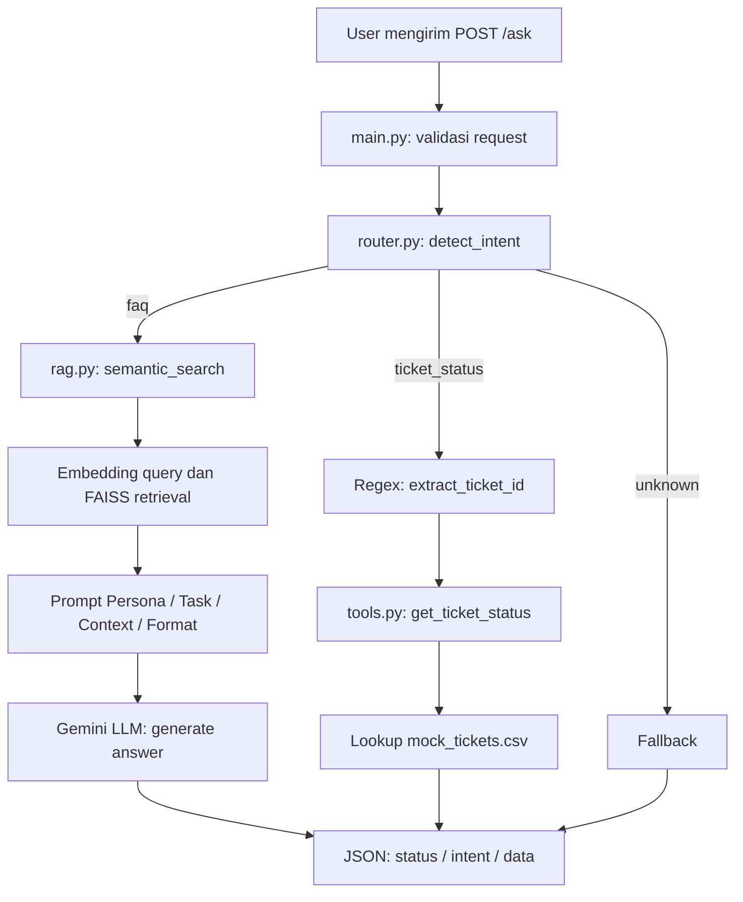

# AI Helpdesk Assistant — RAG & Ticket Status Routing

Prototype backend AI Helpdesk Assistant untuk kebutuhan **People & IT Operations**. Aplikasi menerima pertanyaan karyawan melalui API FastAPI, lalu menentukan apakah permintaan perlu dijawab dari knowledge base (**RAG**) atau dengan pengecekan tiket secara langsung (**tool call**).

> **Status implementasi:** FastAPI, jalur FAQ/RAG, dan pengecekan tiket telah berhasil diuji **secara lokal**. Pengujian build dan run **Docker belum berhasil diverifikasi** karena kendala Docker pada perangkat pengembangan. Error Gemini API `503 UNAVAILABLE` juga pernah dijumpai ketika beban layanan tinggi.

## 1. Problem statement dan objective

Tim People & IT Operations menerima pertanyaan berulang tentang kebijakan perusahaan dan dukungan IT. Tidak semua permintaan bisa diselesaikan dengan pencarian dokumen: pertanyaan kebijakan membutuhkan referensi dari FAQ, sedangkan status tiket harus dibaca dari data tiket tertentu.

**Objective:** membangun satu endpoint yang dapat (1) menjawab FAQ berdasarkan knowledge base, (2) mengenali permintaan status tiket dan mengambil datanya dari CSV mock, dan (3) menghasilkan respons JSON yang konsisten.

### Jenis permintaan

| Intent            | Contoh                                                                          | Penanganan                                                                   |
| ----------------- | ------------------------------------------------------------------------------- | ---------------------------------------------------------------------------- |
| `faq`           | “Bagaimana cara reset password VPN?”; “Berapa jatah cuti tahunan karyawan?” | Semantic search pada FAISS dan jawaban Gemini berdasarkan FAQ yang ditemukan |
| `ticket_status` | “Apa status tiket TICKET-0005?”                                               | Ekstraksi `ticket_id` lalu lookup langsung ke `data/mock_tickets.csv`    |
| `unknown`       | Pertanyaan di luar cakupan atau intent tidak dapat ditentukan                   | Respons fallback; tidak mengarang kebijakan maupun status tiket              |

## 2. Desain workflow



**Kriteria routing:** permintaan yang secara spesifik meminta status tiket diarahkan ke `ticket_status`. Pertanyaan informasi atau kebijakan umum diarahkan ke `faq`. Respons klasifikasi yang tidak valid masuk fallback `unknown`.

**RAG path:** teks FAQ (pertanyaan dan jawaban) diubah menjadi embedding menggunakan model embedding Gemini, dimasukkan ke `faiss.IndexFlatL2`, lalu dicari berdasarkan embedding query. Hasil retrieval menjadi konteks prompt sehingga model generatif diminta menjawab dari data FAQ, bukan menebak.

**Tool path:** setelah `ticket_id` diekstrak, `get_ticket_status()` mencari kecocokan ID pada CSV dan mengembalikan `subject`, `status`, serta `last_update`. ID yang tidak ditemukan mendapat pesan informatif.

## 3. Struktur project

```text
it-helpdesk-assignment/
├── app/
│   ├── __init__.py
│   ├── main.py             # FastAPI /health dan /ask
│   ├── router.py           # Intent detection dan routing
│   ├── rag.py              # Embedding, FAISS, retrieval, jawaban LLM
│   └── tools.py            # Lookup status tiket berdasarkan ID
├── data/
│   ├── it_helpdesk_knowledge_base.csv
│   └── mock_tickets.csv
├── Dockerfile
├── requirements.txt
├── .env.example
├── .gitignore
└── README.md
```

## 4. Persiapan environment

Prasyarat: **Python 3.11**, koneksi internet, dan Gemini API key. Jalankan semua perintah dari **root project** agar path relatif `data/` ditemukan.

### Windows PowerShell

```powershell
py -3.11 -m venv .venv
.\.venv\Scripts\Activate.ps1
python -m pip install -r requirements.txt
Copy-Item .env.example .env
```

### Linux / macOS

```bash
python3.11 -m venv .venv
source .venv/bin/activate
python -m pip install -r requirements.txt
cp .env.example .env
```

Isi `.env` dengan API key pribadi:

```dotenv
GEMINI_API_KEY=isi_api_key_kamu
```

Contoh isi `.env.example` cukup `GEMINI_API_KEY=your_api_key_here`. **Jangan commit `.env` atau API key asli.** Pastikan `.gitignore` mencantumkan `.env` dan `.venv/`.

Model generatif dan model embedding berbeda. Pada implementasi lokal yang diuji, model generatif menggunakan `gemini-3.1-flash-lite` dan model embedding menggunakan `gemini-embedding-001`. Jika akses model berubah, sesuaikan nama model berdasarkan model yang tersedia untuk API key yang digunakan.

## 5. Menjalankan FastAPI secara lokal

```powershell
python -m uvicorn app.main:app --reload
```

Akses dokumentasi interaktif: **http://127.0.0.1:8000/docs**.

Endpoint:

- `GET /health` → `{"status": "ok"}`
- `POST /ask` → menerima `{"query": "..."}` dan mengembalikan `status`, `intent`, `data`.

Contoh request di Swagger UI:

```json
{
  "query": "Apa status tiket TICKET-0005?"
}
```

Contoh respons yang **telah diperoleh saat uji lokal**:

```json
{
  "status": "success",
  "intent": "ticket_status",
  "data": "Ticket ID: TICKET-0005\nSubject: Reset password VPN gagal terus\nStatus: Diproses\nLast Update: 2026-08-27"
}
```

## 6. Pengujian minimal lima skenario

Pengujian dilakukan melalui Swagger UI pada server FastAPI lokal. Pengguna telah menyatakan kelima skenario berjalan sesuai harapan, tetapi respons JSON lengkap hanya terdokumentasi untuk dua contoh di bawah. Tabel membedakan hasil terkonfirmasi dari hasil yang belum disalin ke dokumentasi.

| No. | Query                               | Expected intent        | Observasi                                                                                                                                                                                                                                                                                                                                                                  |
| --- | ----------------------------------- | ---------------------- | -------------------------------------------------------------------------------------------------------------------------------------------------------------------------------------------------------------------------------------------------------------------------------------------------------------------------------------------------------------------------- |
| 1   | Bagaimana cara reset password VPN?  | `faq`                | **Terkonfirmasi:** `success`, `faq`; jawaban menyebut portal self-service IT dan IT Support bila akun terkunci.                                                                                                                                                                                                                                                  |
| 2   | Berapa jatah cuti tahunan karyawan? | `faq`                | **Terkonfirmasi:**`success`, `faq`; sistem mengembalikan pesan <br />"Halo! Sebagai karyawan tetap, Anda mendapatkan jatah 12 hari cuti tahunan yang dapat mulai diambil setelah masa kerja minimal 3 bulan. Semoga informasi ini membantu!" yang berarti agent memberikan informasi cuti tahunan kepada karyawan sesuai dengan knowledge base yang ia miliki. |
| 3   | Apa status tiket TICKET-0005?       | `ticket_status`      | **Terkonfirmasi:** `success`, `ticket_status`; subject *Reset password VPN gagal terus*, status *Diproses*, pembaruan 2026-08-27.                                                                                                                                                                                                                            |
| 4   | Cek status tiket TICKET-9999        | `ticket_status`      | **Terkonfirmasi:`success`, `ticket_status`**; sistem mengembalikan pesan "Maaf, saya tidak menemukan tiket dengan ID TICKET-9999", yang berarti setelah dilakukan pengecekkan tidak ada ticket-9999.                                                                                                                                                            |
| 5   | Siapa pemenang Piala Dunia 2022?    | `unknown` / fallback | **Terkonfirmasi:** `success`, `faq`; router mengklasifikasikan pertanyaan di luar cakupan sebagai FAQ, tetapi RAG berhasil memberikan respons fallback tanpa mengarang informasi di luar knowledge base.                                                                                                                                                         |

**Observasi tambahan:** pada pengujian awal dari ke 5 query di atas, Gemini API pernah mengembalikan error berkali kali pada query ke-4. Hal ini menunjukkan adanya potensi ketidakstabilan layanan LLM saat proses intent detection. Namun, penyebab kegagalan belum dapat dipastikan karena belum dilakukan pemeriksaan traceback secara menyeluruh

7. Docker (konfigurasi dan cara uji)

Docker digunakan untuk mengemas aplikasi AI Helpdesk Assistant beserta source code, dependencies, dan konfigurasi runtime ke dalam sebuah container agar aplikasi dapat dijalankan secara konsisten pada lingkungan yang berbeda.

### 7.1 Konfigurasi Dockerfile

Aplikasi menggunakan base image Python 3.11 dan menjalankan backend FastAPI melalui Uvicorn.

Tahapan konfigurasi Docker meliputi:

1. Menentukan base image Python 3.11.
2. Menetapkan direktori kerja `app/`.
3. Menyalin dan menginstal dependencies dari requirements.txt.
4. Menyalin folder app/ dan `data/` ke dalam container.
5. Mengekspos port 8000.
6. Menjalankan FastAPI menggunakan Uvicorn.

### 7.2 Build Docker Image

Build dari direktori root:

```bash
docker build -t it-helpdesk-assistant .
```

Memeriksa apakah image berhasil dibuat, pastikan ada image bernama `it-helpdesk-assistant`

```bash
docker images
```

### 7.3 Menjalankan Docker Container

Jalankan dengan environment variables dari `.env` lokal:

```bash
docker run --rm --name it-helpdesk-api -p 8000:8000 --env-file .env it-helpdesk-assistant
```

### 7.4 Pengujian Docker Container

```
INFO:     Started server process [1]
INFO:     Waiting for application startup.
INFO:     Application startup complete.
INFO:     Uvicorn running on http://0.0.0.0:8000
```

Selanjutnya, endpoint dapat diuji melalui Swagger UI:
`http://127.0.0.1:8000/docs`

## 8. Keterbatasan dan pengembangan lanjutan

**Ketergantungan Gemini API:** Sistem dapat mengalami error `503` atau `404`. Pengembangan selanjutnya dapat menambahkan mekanisme retry dan fallback.
