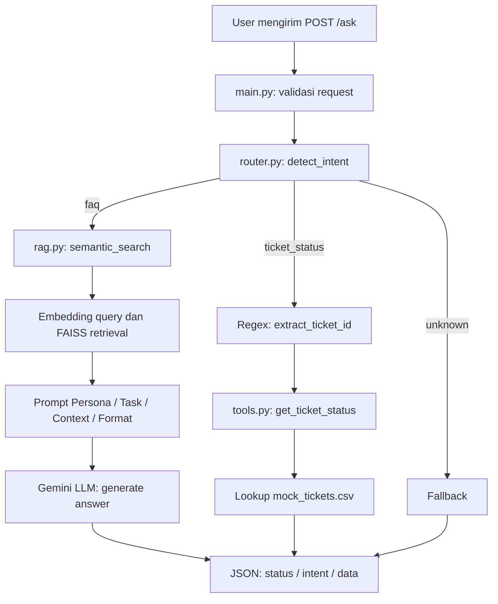

# AI Helpdesk Assistant — RAG & Ticket Status Routing

Prototype backend AI Helpdesk Assistant untuk kebutuhan **People & IT Operations**. Aplikasi menerima pertanyaan karyawan melalui API FastAPI, lalu menentukan apakah permintaan perlu dijawab dari knowledge base (**RAG**) atau dengan pengecekan tiket secara langsung (**tool call**).

> **Status implementasi:** FastAPI, jalur FAQ/RAG, dan pengecekan tiket telah berhasil diuji **secara lokal**. Pengujian build dan run **Docker belum berhasil diverifikasi** karena kendala Docker pada perangkat pengembangan. Error Gemini API `503 UNAVAILABLE` juga pernah dijumpai ketika beban layanan tinggi.

## 1. Problem statement dan objective

Tim People & IT Operations menerima pertanyaan berulang tentang kebijakan perusahaan dan dukungan IT. Tidak semua permintaan bisa diselesaikan dengan pencarian dokumen: pertanyaan kebijakan membutuhkan referensi dari FAQ, sedangkan status tiket harus dibaca dari data tiket tertentu.

**Objective:** membangun satu endpoint yang dapat (1) menjawab FAQ berdasarkan knowledge base, (2) mengenali permintaan status tiket dan mengambil datanya dari CSV mock, dan (3) menghasilkan respons JSON yang konsisten.

### Jenis permintaan

| Intent | Contoh | Penanganan |
|---|---|---|
| `faq` | “Bagaimana cara reset password VPN?”; “Berapa jatah cuti tahunan karyawan?” | Semantic search pada FAISS dan jawaban Gemini berdasarkan FAQ yang ditemukan |
| `ticket_status` | “Apa status tiket TICKET-0005?” | Ekstraksi `ticket_id` lalu lookup langsung ke `data/mock_tickets.csv` |
| `unknown` | Pertanyaan di luar cakupan atau intent tidak dapat ditentukan | Respons fallback; tidak mengarang kebijakan maupun status tiket |

### Batasan dan asumsi

- Knowledge base **hanya** menggunakan `data/it_helpdesk_knowledge_base.csv` (31 FAQ); data tiket **hanya** menggunakan `data/mock_tickets.csv` (15 tiket).
- Data tiket adalah **mock**, bukan integrasi langsung ke sistem ticketing perusahaan; tidak ada pembuatan atau pembaruan tiket.
- Pola ID tiket mengikuti `TICKET-XXXX` pada dataset. Ekstraksi dilakukan dengan regex.
- Klasifikasi intent dan penyusunan jawaban menggunakan Gemini API; output dapat dipengaruhi ketersediaan layanan, kuota, dan hasil klasifikasi model.
- Embedding knowledge base disimpan dalam index FAISS **di memori aplikasi**. Index dibangun saat dibutuhkan dan akan dibangun kembali setelah proses restart; belum ada penyimpanan index permanen.
- Aplikasi ini adalah prototype lokal; autentikasi pengguna, otorisasi akses tiket, audit log, dan deployment cloud belum diimplementasikan.

## 2. Desain workflow



**Kriteria routing:** permintaan yang secara spesifik meminta status tiket diarahkan ke `ticket_status`. Pertanyaan informasi atau kebijakan umum diarahkan ke `faq`. Respons klasifikasi yang tidak valid masuk fallback `unknown`.

**RAG path:** teks FAQ (pertanyaan dan jawaban) diubah menjadi embedding menggunakan model embedding Gemini, dimasukkan ke `faiss.IndexFlatL2`, lalu dicari berdasarkan embedding query. Hasil retrieval menjadi konteks prompt sehingga model generatif diminta menjawab dari data FAQ, bukan menebak.

**Tool path:** setelah `ticket_id` diekstrak, `get_ticket_status()` mencari kecocokan ID pada CSV dan mengembalikan `subject`, `status`, serta `last_update`. ID yang tidak ditemukan mendapat pesan informatif.

## 3. Struktur project

```text
it-helpdesk-assignment/
├── app/
│   ├── __init__.py
│   ├── main.py             # FastAPI /health dan /ask
│   ├── router.py           # Intent detection dan routing
│   ├── rag.py              # Embedding, FAISS, retrieval, jawaban LLM
│   └── tools.py            # Lookup status tiket berdasarkan ID
├── data/
│   ├── it_helpdesk_knowledge_base.csv
│   └── mock_tickets.csv
├── Dockerfile
├── requirements.txt
├── .env.example
├── .gitignore
└── README.md
```

## 4. Persiapan environment

Prasyarat: **Python 3.11**, koneksi internet, dan Gemini API key. Jalankan semua perintah dari **root project** agar path relatif `data/` ditemukan.

### Windows PowerShell

```powershell
py -3.11 -m venv .venv
.\.venv\Scripts\Activate.ps1
python -m pip install -r requirements.txt
Copy-Item .env.example .env
```

### Linux / macOS

```bash
python3.11 -m venv .venv
source .venv/bin/activate
python -m pip install -r requirements.txt
cp .env.example .env
```

Isi `.env` dengan API key pribadi:

```dotenv
GEMINI_API_KEY=isi_api_key_kamu
```

Contoh isi `.env.example` cukup `GEMINI_API_KEY=your_api_key_here`. **Jangan commit `.env` atau API key asli.** Pastikan `.gitignore` mencantumkan `.env` dan `.venv/`.

Model generatif dan model embedding berbeda. Pada implementasi lokal yang diuji, model generatif menggunakan `gemini-3.1-flash-lite` dan model embedding menggunakan `gemini-embedding-001`. Jika akses model berubah, sesuaikan nama model berdasarkan model yang tersedia untuk API key yang digunakan.

## 5. Menjalankan FastAPI secara lokal

```powershell
python -m uvicorn app.main:app --reload
```

Akses dokumentasi interaktif: **http://127.0.0.1:8000/docs**.

Endpoint:

- `GET /health` → `{"status": "ok"}`
- `POST /ask` → menerima `{"query": "..."}` dan mengembalikan `status`, `intent`, `data`.

Contoh request di Swagger UI:

```json
{
  "query": "Apa status tiket TICKET-0005?"
}
```

Contoh respons yang **telah diperoleh saat uji lokal**:

```json
{
  "status": "success",
  "intent": "ticket_status",
  "data": "Ticket ID: TICKET-0005\nSubject: Reset password VPN gagal terus\nStatus: Diproses\nLast Update: 2026-08-27"
}
```

## 6. Pengujian minimal lima skenario

Pengujian dilakukan melalui Swagger UI pada server FastAPI lokal. Pengguna telah menyatakan kelima skenario berjalan sesuai harapan, tetapi respons JSON lengkap hanya terdokumentasi untuk dua contoh di bawah. Tabel membedakan hasil terkonfirmasi dari hasil yang belum disalin ke dokumentasi.

| No. | Query | Expected intent | Observasi |
|---|---|---|---|
| 1 | Bagaimana cara reset password VPN? | `faq` | **Terkonfirmasi:** `success`, `faq`; jawaban menyebut portal self-service IT dan IT Support bila akun terkunci. |
| 2 | Berapa jatah cuti tahunan karyawan? | `faq` | **Dilaporkan lulus** pada pengujian lokal; salin respons aktual dari Swagger jika tersedia. |
| 3 | Apa status tiket TICKET-0005? | `ticket_status` | **Terkonfirmasi:** `success`, `ticket_status`; subject *Reset password VPN gagal terus*, status *Diproses*, pembaruan 2026-08-27. |
| 4 | Cek status tiket TICKET-9999 | `ticket_status` | **Dilaporkan lulus**; fungsi seharusnya memberi pesan tiket tidak ditemukan tanpa crash. Salin respons aktual jika tersedia. |
| 5 | Siapa pemenang Piala Dunia 2022? | `unknown` / fallback | **Dilaporkan diuji**; respons aktual dan klasifikasi perlu dicatat untuk memverifikasi perilaku out-of-scope. |

**Observasi tambahan:** pada pengujian awal, Gemini API pernah mengembalikan `404 NOT_FOUND` akibat pemilihan model yang tidak cocok/tidak tersedia dan `503 UNAVAILABLE` akibat beban layanan. Model kemudian disesuaikan. Error API ditangani sehingga endpoint memberi respons terstruktur dan aplikasi tidak berhenti.

## 7. Docker (konfigurasi dan cara uji)

> **Belum terverifikasi:** Docker Desktop pada perangkat pengembangan masih bermasalah. Instruksi berikut adalah langkah yang **perlu dijalankan**, bukan klaim bahwa image sudah berhasil di-build.

Pastikan `Dockerfile` memuat Python 3.11, memasang dependencies dari `requirements.txt`, menyalin folder `app/` dan `data/`, membuka port 8000, serta menjalankan Uvicorn pada host `0.0.0.0`.

Build dari direktori root:

```bash
docker build -t it-helpdesk-assistant .
```

Jalankan dengan environment variables dari `.env` lokal:

```bash
docker run --rm --name it-helpdesk-api -p 8000:8000 --env-file .env it-helpdesk-assistant
```

Periksa **http://127.0.0.1:8000/health** dan **http://127.0.0.1:8000/docs**; kirim kembali query FAQ dan status tiket melalui `/ask`. Hentikan server Uvicorn lokal sebelum menggunakan port 8000 untuk container. Pastikan `.dockerignore` mengecualikan `.env`, `.venv/`, dan `__pycache__/`.

## 8. Keterbatasan dan pengembangan lanjutan

1. Ketergantungan pada Gemini API menyebabkan kegagalan sementara saat layanan tidak tersedia (`503`) atau nama model tidak kompatibel (`404`). Retry/backoff dapat ditambahkan pada pengembangan berikutnya.
2. Intent detection berbasis LLM dapat keliru mengklasifikasikan pertanyaan ambigu atau di luar cakupan. Validasi intent, keyword baseline, dan aturan fallback dapat diperkuat.
3. Semantic search belum memakai ambang relevansi yang tervalidasi; konteks yang kurang relevan bisa tetap diteruskan ke model.
4. FAISS index disimpan di memori, sehingga embedding knowledge base mungkin dihitung kembali ketika aplikasi restart dan dapat menghabiskan waktu serta kuota API.
5. Data tiket mock belum memiliki autentikasi atau pembatasan akses; **tidak cocok langsung dipakai sebagai sistem produksi**.
6. Docker build/run belum terverifikasi pada perangkat lokal dan masih menjadi pekerjaan lanjutan.

## 9. Keamanan dan submission

- Push hanya source code, dua dataset dari starter repository, `requirements.txt`, `Dockerfile`, `.env.example`, dan `README.md`.
- Pastikan `.env` **tidak** masuk Git. Verifikasi menggunakan `git status` sebelum commit.
- Nama repository mengikuti format **`assignment-helpdesk-agent-nama-peserta`**.
- Repository harus dapat diakses oleh mentor.

---

**Catatan penilaian:** Dokumentasi ini sengaja tidak menyatakan Docker sudah berhasil karena pengujian container belum selesai. Setelah Docker berfungsi, tambahkan hasil build/run dan bukti respons endpoint dalam container.
